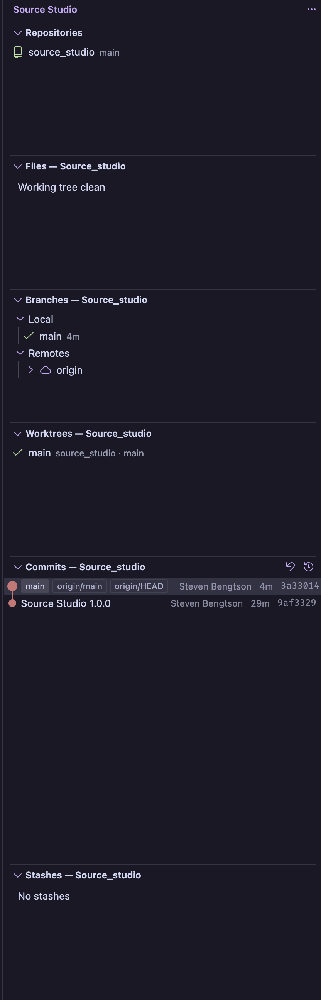
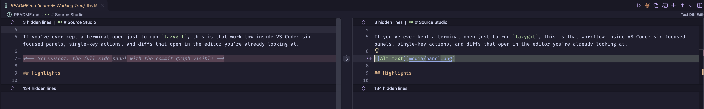
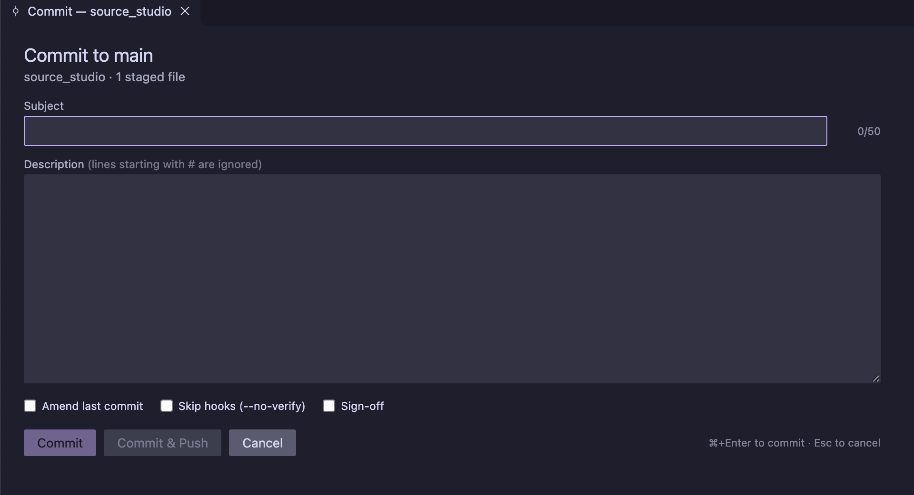

# Source Studio

**lazygit-style source control for VS Code.** Keyboard-driven staging, branches, worktrees, stashes, a commit graph, interactive rebase, blame and undo — across every repository in your workspace, without leaving the editor.

If you've ever kept a terminal open just to run `lazygit`, this is that workflow inside VS Code: six focused panels, single-key actions, and diffs that open in the editor you're already looking at.



## Highlights

- **Multiple repositories, one panel.** Every repo in the workspace is found automatically (including nested ones). Pick the active repo and every view follows it. The activity-bar badge shows the total number of changes.
- **Stage like lazygit.** `space` toggles a file, `a` stages everything, checkboxes stage whole folders. Open any file and stage, unstage or discard individual lines and hunks straight from the diff editor.
- **A real commit panel.** Subject and description, 50/72 counter, amend, `--no-verify`, sign-off, commit & push. Pre-filled from your commit template (`commit.template`, `.gitmessage`, or a PR template) and the ticket key in your branch name.
- **Commit graph with history rewriting.** Squash, fixup, reword, drop, reorder and edit commits with one key each. Cherry-pick, revert, reset, branch from any commit.
- **Undo.** `z` walks the reflog to undo the last commit, rebase, reset, checkout or merge; `Z` redoes. A reflog browser is there for anything deeper.
- **Branches, worktrees and stashes** as first-class views with checkout, create, delete, rename, rebase-onto, merge-into, fast-forward, upstream, switch worktree, apply/pop/drop stash.
- **Conflicts handled.** When a rebase, merge, cherry-pick or stash-apply stops on conflicts, the Files view shows them and Continue/Abort appear in the toolbar.
- **Blame** per file (gutter annotations) or for the current line, with hover cards linking to the commit.

## The panels

Press `1`–`6` from any Source Studio view to jump between them, `?` to see the keymap.

| # | View | What it shows |
|---|---|---|
| 1 | **Repositories** | Every repo with its branch, ahead/behind and change count. Click to make it active. |
| 2 | **Files** | Conflicts, staged, unstaged and untracked files, nested by folder. Click a file for its diff, a folder for a multi-diff. |
| 3 | **Branches** | Local branches by recency (current pinned), remotes grouped by name. |
| 4 | **Worktrees** | Every worktree of the active repo; switch, create, remove, prune. |
| 5 | **Commits** | The graph for the checked-out branch (`a` for all branches). Hollow dots are unpushed. |
| 6 | **Stashes** | Click to see a stash's contents. |



## Keymap

Keys work while a Source Studio view has focus and don't interfere with the editor.

**Everywhere**

| Key | Action |
|---|---|
| `c` | Commit (opens the commit panel) |
| `P` / `p` / `f` | Push / Pull / Fetch |
| `z` / `Z` | Undo / Redo (reflog-based) |
| `?` | Keymap |

**Files**

| Key | Action |
|---|---|
| `space` | Stage / unstage selection |
| `a` | Stage all |
| `d` | Discard |
| `s` | Stash (all / staged / with untracked) |
| `A` | Amend HEAD with staged changes |
| `R` | Refresh |

**Branches**

| Key | Action |
|---|---|
| `space` | Checkout (remote branches get a tracking branch) |
| `n` | New branch from selected |
| `d` | Delete (offers force-delete; confirms remote deletes) |
| `R` | Rename |
| `r` | Rebase current branch onto selected |
| `M` | Merge selected into current |
| `u` | Set upstream |

**Commits**

| Key | Action |
|---|---|
| `j` / `k`, `Enter` | Move, show diff |
| `space` | Checkout commit (detached) |
| `n` | New branch at commit |
| `c` / `t` | Cherry-pick / Revert |
| `g` | Reset to commit (soft / mixed / hard) |
| `s` / `f` | Squash / fixup into parent |
| `r` / `d` / `e` | Reword / Drop / Edit (pause rebase) |
| `J` / `K` | Move commit down / up |
| `y` | Copy SHA |
| `a` | Toggle all branches |

**Worktrees** — `space` switch, `n` new, `d` remove. **Stashes** — `space` apply, `g` pop, `d` drop, `n` new.

**In a diff editor**

| Key | Action |
|---|---|
| `alt+s` / `alt+h` | Stage selected lines / hunk |
| `alt+u` / `alt+shift+h` | Unstage selected lines / hunk (in the HEAD ↔ Index diff) |
| right-click | Discard selected lines / hunk |

**In any editor** — `alt+b` toggles file blame; right-click for line blame.



## Commit panel

`c` opens a tab with a subject line, description, and toggles for amend, `--no-verify` and sign-off. `⌘/Ctrl+Enter` commits, `⌘/Ctrl+Shift+Enter` commits and pushes. Lines starting with `#` are stripped, so comment-style templates work as they do in a terminal. Drafts are kept per repository until you commit.

The description is pre-filled from, in order: git's `commit.template`, then the files in `sourcestudio.commit.templateFiles` (defaults cover `.gitmessage` and the common `pull_request_template.md` locations). The subject is seeded from the ticket key in the branch name, e.g. `feature/PLA-123-thing` → `PLA-123: `.

## Settings

| Setting | Default | Purpose |
|---|---|---|
| `sourcestudio.gitPath` | `git` | Path to the git executable |
| `sourcestudio.scanDepth` | `3` | How deep to look for repositories under each workspace folder |
| `sourcestudio.ignoredFolders` | `node_modules`, `dist`, … | Folders skipped while scanning |
| `sourcestudio.commit.templateFiles` | `.gitmessage`, `pull_request_template.md`, … | Commit-template files to try, relative to the repo root |
| `sourcestudio.commit.branchPrefixPattern` | `(?:^\|/)([A-Z][A-Z0-9]+-\d+)` | Regex that pulls a ticket key from the branch name (empty to disable) |
| `sourcestudio.commit.branchPrefixFormat` | `{match}: ` | How the key is inserted into the subject |

## Requirements

- VS Code 1.90 or newer
- git 2.35 or newer on your PATH (for `stash --staged` and `switch`)

Source Studio runs git directly; it doesn't replace or disable VS Code's built-in Git support, and the two coexist.

## Safety

Destructive actions — discard, drop, hard reset, force-delete, remote-branch delete — always ask first. History rewrites run with `--autostash`, so a dirty working tree is stashed and restored around them. Nearly everything can be reversed with `z`.

## Feedback

Bugs and ideas: [github.com/eventtemple/source_studio/issues](https://github.com/eventtemple/source_studio/issues).

## Contributing

```sh
git clone https://github.com/eventtemple/source_studio
cd source_studio && npm install
npm run watch        # rebuild on save
# F5 in VS Code → "Run Extension"
npm run typecheck    # tsc --noEmit
npm run package      # build a .vsix
```

The code is plain TypeScript bundled with esbuild: `src/git/` wraps git and parses its porcelain output, `src/views/` holds the six panels, `src/commands/` the actions, and `src/blame/` the annotations. See `CHANGELOG.md` for release notes.
